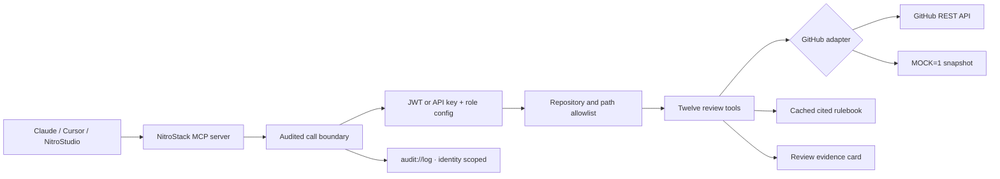

# PR Archaeologist

**Reviewers see a diff with no memory. PR Archaeologist brings back the decisions.**

A GitHub PR review MCP server for the **MCP to the Moon buildathon · Developer Tools** track. Built with NitroStack and TypeScript, with twelve focused tools, cited team rules, role-scoped access, and a review evidence widget.

## The problem

A small cleanup deletes a timeout. The diff looks simpler. Two years earlier, that timeout fixed an outage. The reason lives in a review comment nobody remembers to search for.

PR Archaeologist traces the line back to the incident, finds the team convention that grew around it, and warns when a new PR reverses the fix. Every warning links to its evidence. The agent's credentials determine which repository paths it can see and whether it can post.

| Before: diff alone | After: review with memory |
| --- | --- |
| `fetch(url)` replaces a longer call | Line provenance explains the worker-exhaustion incident |
| An old convention is absent from the diff | A finding quotes the 2024 review comment and its URL |
| A deliberate fix looks like boilerplate | An exact reverse of PR #42's fix triggers a conflict warning |
| Reviewer choice relies on recall | Path history suggests Nikhil, Ava and Mina with evidence |
| Repository access is all or nothing | A readonly request for `.env` returns `not found`; posting is a dry run |

The before/after is an illustrative fixture scenario, not a measured comparison between models. Fixture links have GitHub's normal URL shape but point to the fictional `acme/launchpad` repository. Live mode returns real GitHub URLs.

## How it fits together



## Tools

| Tool | One job |
| --- | --- |
| `pr_context(repo, pr)` | Visible file patches, author, closing issues, related merged PRs on the same files, and review docs |
| `read_pr_file(repo, pr, path, start_line=1, end_line?)` | Read up to 200 lines at the pinned PR head, including unchanged files needed for context |
| `pr_discussion(repo, pr)` | Visible inline comments and replies, submitted reviews and general PR comments, with source links |
| `pr_changes_since(repo, pr, since)` | Visible patches since an earlier full commit SHA; detect diverged history and report incomplete comparisons |
| `recheck_findings(repo, pr, previous_findings)` | Match saved rule findings across line shifts and visible renames; report `still_detected`, `not_detected` or `unverified` |
| `why_line(repo, path, line)` | Default-branch line introduction → commit → merged PR → matching review comments → closing issue |
| `extract_team_rules(repo, n=300)` | Recurring review conventions with source quotes, URLs, independent PR support and confidence; `@Cache` for five minutes |
| `check_pr_against_rules(repo, pr)` | Added-line findings with the rule and original comment; attaches `@Widget('review-card')` |
| `decision_conflicts(repo, pr)` | Exact reverse-line evidence that a PR undoes a historical fix or revert |
| `find_reviewers(repo, pr)` | Rank same-path authors and reviewers; return supporting links without notifying anyone |
| `draft_review(repo, pr)` | Prepare cited inline comments from findings and historical conflicts. An exact past one-line fix becomes a GitHub `suggestion` block the author can commit. Returns arguments ready for `post_review` |
| `post_review(repo, pr, body, comments)` | A GitHub `COMMENT` review, guarded by `@UseGuards` and `@RateLimit` |

Review comments use `{ "path": "src/client.ts", "line": 3, "body": "Keep the timeout." }`. Lines refer to added lines on the **right** side of the current PR diff. Posting pins `commit_id`, validates locations, and rejects a head change observed during preparation. `why_line` uses **default-branch** line numbers, which can differ from PR line numbers.

`draft_review` returns a `review` object containing `repo`, `pr`, `body`, `comments`, and `expected_head`, plus `apply_ready`. Pass that object to `post_review` after inspecting it. A comment with a `suggestion` fence carries the exact historical replacement; GitHub can commit that line from the review. Lines without an exact past replacement stay explanatory. The head check rejects a draft if the PR changes before posting. Drafts preserve docs-bot's empty summary and docs-only comments, report suggestions omitted by the 50-comment/5000-character posting limits, and retain coverage warnings. No findings does not mean approval.

The rule miner supports four conservative families: fetch timeouts, structured logging, stable retry idempotency keys, and Markdown code-fence language tags. It requires review evidence from at least two merged PRs per rule. Confidence is `min(0.95, 0.55 + 0.10 × supporting PRs)`, a support heuristic, **not a calibrated probability**. No additional LLM key or paid inference is required.

For a follow-up review, keep the earlier head SHA and checker findings in the client conversation. `review-pr-update` takes `repo`, `pr` and that SHA. It guides the agent through changes, existing discussion, surrounding code and a fresh draft. If the earlier head is no longer an ancestor, `pr_changes_since` returns `history_changed` and calls for a full review. GitHub comparison files are capped at 300, and missing patches are listed. [GitHub comparison limits](https://docs.github.com/en/rest/commits/commits#compare-two-commits).

`recheck_findings` accepts the earlier checker array as `previous_findings` (up to 100 entries with `path`, `line`, `rule_id` and `code`). Matching uses the visible path, rule and trimmed code; it is not semantic verification. `not_detected` does not prove a fix, and missing patches or redacted code are `unverified`. `pr_discussion` does not infer resolved-thread status, which REST does not provide. These four tools never post or resolve comments.

## Roles and authentication

Edit [config/roles.json](config/roles.json) to choose allowed repositories, path prefixes and posting permissions. A trailing `/` is a directory prefix; other entries are exact file paths. There are no implicit wildcard repositories or paths.

| Role | Default visible paths | Posting | Mock credential |
| --- | --- | --- | --- |
| `readonly` | `src/`, `docs/`, `README.md` | Validated dry run | `demo-readonly` |
| `reviewer` | `src/`, `docs/`, `README.md` | Full review on visible added lines | `demo-reviewer` |
| `docs-bot` | `docs/` | Docs inline comments only; summary must be empty | `demo-docs-bot` |

Every tool authenticates. `.env*`, `*.pem`, any `secrets/` component, traversal, encoded paths, and paths outside the allowlist return `not found`. A rename is visible only if **both** paths are allowed. A symlink is readable only when its target is allowed too. A path missing from a full 3000-file change list is not readable, because that list can omit a rename. File filtering happens before patch assembly. Free text mentioning unavailable paths is suppressed as a whole field. Repository text is untrusted evidence, never agent instructions. This is path-based protection, not arbitrary secret-value detection in otherwise permitted files.

Mock keys work **only** with `MOCK=1`. Live mode requires either:

- An API key in the environment variable named by the role's `apiKeyEnv` field (`READONLY_API_KEY`, `REVIEWER_API_KEY`, `DOCS_BOT_API_KEY` by default).
- An HS256 JWT signed with `JWT_SECRET` (at least 32 characters), with `iss` and `aud` equal to `pr-archaeologist`, a nonempty `sub`, a configured `role`, and future `exp`. `nbf`, if present, is checked. Unsigned claims never select a role.

For local stdio, `MCP_API_KEY` chooses the process identity. NitroStudio can also send `apiKey` in tool request `_meta`. HTTP clients send `Authorization: Bearer <api-key-or-jwt>` on every request. A caller cannot select a role through tool arguments. HTTP never falls back to the server's stdio credential.

Posting is limited to **five calls per minute per identity per process**, including dry runs and attempts rejected after authentication. Mock posting is in memory and never contacts GitHub. For live reviewer credentials, `post_review` really posts; the supplied prompt asks the user to review the exact draft first.

## Run locally

Use **Node.js 22.18+ or 24 LTS** and npm. The project was created using `@nitrostack/cli`'s TypeScript starter.

```powershell
cd C:\Users\sayal\pr-archaeologist
npm ci
npm --prefix src/widgets ci
Copy-Item .env.example .env
npm test
npm run demo
npm run dev
```

`npm test` builds the server and self-contained widget HTML, checks both TypeScript projects, and exercises mock services, real stdio MCP calls, production HTTP, security boundaries and widget DOM rendering. No GitHub token or network request to GitHub is used by tests. Installing packages requires the npm registry.

`npm run demo` executes the full scenario over MCP, asserts the expected evidence and denied secret access, and writes `logs/demo-output.json`. It always uses mock readonly credentials, regardless of your live configuration.

Open [NitroStudio](https://nitrostack.ai/studio), open this project folder, and test `pr_context` with `{"repo":"acme/launchpad","pr":207}`. The copied `.env` selects `demo-readonly`. Run `check_pr_against_rules` for the card, read the three resources, and select `review-like-a-senior` in Prompts. In Widgets, the manifest provides a generated **Fixture PR #207** example. [Official Studio setup](https://docs.nitrostack.ai/installation).

The widget development preview is `http://localhost:3001/preview`; the host-connected widget is `/review-card`. The preview is explicitly fictional public fixture data, never live repository data. If needed, start just the widget server with `npm run widget -- run dev`. Production MCP HTML embeds its CSS because NitroStack 1.1.2's page bundler bypasses Next's root layout. `npm run widget:example` regenerates the manifest from the mock checker; rebuild afterward.

To use GitHub, set `MOCK=0`, `GITHUB_TOKEN`, a real role API key or JWT secret, and update each role's `repos` and `allow` lists. Set `REPO=owner/repository` for resources. A fine-grained GitHub token needs repository Contents, Issues and Pull requests read access; posting additionally needs Pull requests write access. The server token is never returned to clients.

## Resources and prompts

| URI / name | Contents |
| --- | --- |
| `repo://rules` | Learned rulebook as JSON for `REPO`, scoped to the verified role |
| `repo://decisions` | Visible fix/revert PR timeline, oldest first |
| `audit://log` | Latest 200 entries for the current verified subject **and** role |
| `review-like-a-senior` | Context → rules and checks → conflicts → reviewers → cited draft → role-appropriate posting |
| `review-pr-update` | Changes since the earlier head → discussion and surrounding code → saved finding recheck → fresh draft |

Calls append role, subject, tool, sanitized arguments, allowed/denied and result status to `logs/audit.jsonl`. Review bodies are recorded as length and SHA-256, hidden paths are redacted, and credentials are omitted. Cached calls still traverse authentication and auditing. The built-in widget example resource is also authenticated and filtered by role.

## Claude and Cursor

Merge [examples/claude-desktop.json](examples/claude-desktop.json) into Claude Desktop's MCP configuration, or [examples/cursor-mcp.json](examples/cursor-mcp.json) into Cursor's `.cursor/mcp.json`. Restart the client. Change the absolute script path if you clone elsewhere. The launcher sets its own working directory, so the fixture, role config and widget are found even when the client starts elsewhere.

Both files use this entry:

```json
{
  "mcpServers": {
    "pr-archaeologist": {
      "command": "node",
      "args": ["C:/Users/sayal/pr-archaeologist/scripts/mcp.mjs"],
      "env": {
        "MOCK": "1",
        "MCP_API_KEY": "demo-readonly",
        "NITRO_MCP_PROTOCOL_VERSION": "legacy"
      }
    }
  }
}
```

Ask: **“Review acme/launchpad PR 207 like a senior. Explain why src/client.ts line 3 exists, cite the team rules, check old fixes, suggest reviewers, and prepare a dry run.”**

## Deploy to NitroCloud

This project provides a deployment bundle; no cloud project has been created or deployed by this implementation session.

1. Run `npm test` and `npm run demo` locally.
2. Run `npm run pack -- --dry-run`, then `npm run pack`. The CLI creates `pr-archaeologist.zip`, excluding dependencies, build artifacts, `.git`, logs and real `.env` files. Inspect it before uploading; **do not use `--include-env`**. [Official pack reference](https://docs.nitrostack.ai/cli/pack).
3. Sign in to [NitroCloud](https://nitrostack.ai/cloud), create an MCP server project and choose ZIP upload. Upload that bundle. Git-based deployment can use [kshirajahere/pr-archaeologist](https://github.com/kshirajahere/pr-archaeologist). [NitroCloud deployment options](https://nitrostack.ai/cloud).
4. Use Node 24. Install with `npm ci --include=dev` and `npm --prefix src/widgets ci --include=dev`, build with `npm run build`, and start with `npm start`. Build-time dependencies include the CLI and TypeScript. Keep `dist/`, `src/widgets/out/`, the widget manifest, `config/` and `fixtures/` available at runtime.
5. For the buildathon demo, set `MOCK=1`, `REPO=acme/launchpad`, `MCP_TRANSPORT_TYPE=http`, `HOST=0.0.0.0`, `PORT` to the platform's assigned port, and `NITRO_MCP_PROTOCOL_VERSION=auto`. Clients send `Bearer demo-readonly` or the other explicit mock credential. Leave `GITHUB_TOKEN` empty.
6. For real repository use, set `MOCK=0`, supply `GITHUB_TOKEN` and real role credentials in NitroCloud's secret settings, and package your updated role allowlists. Never use a demo credential for live mode.
7. Check `GET /mcp/health`, connect an MCP client to `https://<your-server>/mcp` with its Authorization header, list twelve tools, run the fixture review, and confirm unauthenticated reads and `.env` access fail. Resource and tool HTTP isolation is covered by the local integration test.

NitroCloud's UI/build settings may evolve; use its current upload flow. The installed CLI's `pack` command is verified locally; this README does not assume unimplemented CLI `login` or `deploy` commands.

## Evidence and limits

- The fixture is a deliberately fictional, realistic snapshot: PR #207 regresses a timeout, logs and retry key; #208 is a clean docs change; #209 tries to rename a secret into docs. It includes merged PRs, issues, review threads, four recurring conventions and fake `.env`/PEM contents for denial tests.
- Live GitHub behavior was verified through real MCP stdio on a separate pull request: all twelve tools, three resources and both prompts passed, with posting restricted to a readonly dry run. That repository has no supported recurring rules; this verifies live integration, not detection accuracy. REST adapter edge cases also use injected HTTP tests. GitHub REST has no blame endpoint: provenance walks up to 100 path commits, pins a default-branch snapshot, and stops at merges, renames or missing patches. It reports incomplete evidence instead of inventing a reason.
- Rules scan up to `n` merged PRs among the latest 3000 closed PRs ordered by update, and up to 300 comments per PR. Related history, decisions and reviewers use up to 100 merged PRs. This is bounded history, not every decision ever made. GitHub's missing or truncated patches and its 3000-file PR ceiling constrain coverage. A file read is refused when a symlink target is outside the role, or when the path is missing from a full 3000-file change list.
- Added-line checks support single-line fetch/retry calls and diff-visible fence state. They are review suggestions, not semantic correctness proofs. Reversed lines identify candidate decision conflicts; a human decides whether the old incident still applies.
- Cache and rate limits are in memory per process. The JSONL audit is local; for durable cloud audit, set `AUDIT_FILE` to persistent storage or arrange log collection. Autoscaled instances do not share cache or rate counters. Authentication and path restrictions still apply on every call.
- The production bundle has DOM rendering tests, including source links and HTML escaping. The fixture preview was also visually checked in Chrome at desktop and 390-pixel mobile widths. NitroStudio GUI and NitroCloud deployment remain unverified.
- Initial stage checks and current verification are recorded in [CHECKPOINTS.md](CHECKPOINTS.md). See [BUILDATHON.md](BUILDATHON.md) for the guide-based demo priorities and remaining submission requirements.

See [DEMO.md](DEMO.md) for the 90-second presentation.
